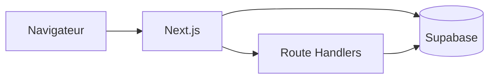

<div style="text-align: center; margin-top: 120px;">

# Conception et réalisation de CogniTest

## Plateforme web de batteries cognitives et mathématiques numériques

<br><br>

**Projet de Fin d'Études (PFE)**

<br>

**Réalisé par :** [Nom de l'étudiant(e)]  
**Formation :** [École / Université]  
**Organisme d'accueil :** [Organisme d'accueil — ex. Laboratoire / ENS Fès]  
**Encadrants :** [Encadrant académique] · [Encadrant technique]  
**Période :** [Dates du stage]  
**Année universitaire :** [Année universitaire]

</div>

<div style="page-break-after: always;"></div>

## Table des matières

1. [Introduction générale](#introduction-générale)
2. [Chapitre 1 — Cadre général du projet](#chapitre-1--cadre-général-du-projet)
3. [Chapitre 2 — Étude fonctionnelle](#chapitre-2--étude-fonctionnelle)
4. [Chapitre 3 — Étude conceptuelle](#chapitre-3--étude-conceptuelle)
5. [Chapitre 4 — Réalisation du projet](#chapitre-4--réalisation-du-projet)
6. [Conclusion générale](#conclusion-générale)
7. [Perspectives](#perspectives)
8. [Webographie](#webographie)

<div style="page-break-after: always;"></div>

## Résumé

Ce rapport présente le travail réalisé dans le cadre du Projet de Fin d'Études portant sur **CogniTest**, une application web d'évaluation des capacités cognitives et des compétences en géométrie. La plateforme adresse les limites des protocoles papier (dispersion, absence de traçabilité, correction manuelle) en proposant un parcours numérique unifié pour les **élèves**, les **enseignants** et les **équipes de recherche**.

La solution repose sur **Next.js 16** (App Router, React 19), **TypeScript**, **Tailwind CSS 4** et **Supabase** (authentification, PostgreSQL, Row Level Security). Elle couvre **sept domaines** d'évaluation — attention, raisonnement, cognition spatiale, traitement visuel, mémoire, fonctions exécutives et géométrie — avec des interfaces dédiées par batterie et un lanceur générique pour les QCM.

Les résultats sont persistés dans `test_sessions` et `trial_results`, avec fusion dynamique du catalogue (`mockTests` + table `public.tests`). Le déploiement cible **Netlify**. Les perspectives portent sur la migration complète vers Supabase, les tests automatisés et la conformité RGPD.

**Mots-clés :** évaluation cognitive, géométrie, Next.js, Supabase, psychométrie, PFE.

<div style="page-break-after: always;"></div>

## Abstract

This report describes **CogniTest**, a web platform for administering cognitive and geometry assessment batteries. Built with Next.js 16, React 19, and Supabase, it provides role-based journeys for students, teachers, and researchers, dedicated test UIs per battery, and centralized session storage. Future work includes full Supabase migration for legacy browser storage, E2E testing, and data protection compliance.

<div style="page-break-after: always;"></div>

# Introduction générale

L'évaluation des capacités cognitives et des apprentissages en mathématiques occupe une place centrale dans la recherche en psychologie de l'éducation et dans l'accompagnement des élèves en difficulté. Les batteries traditionnelles (visuo-motrices, perceptives, attentionnelles, mnésiques, de raisonnement) sont encore largement administrées sur support papier, ce qui complique la centralisation des données, le suivi longitudinal et l'analyse statistique à l'échelle d'une classe ou d'un établissement.

Dans ce contexte, le projet **CogniTest** vise à concevoir et déployer une **plateforme web responsive** permettant :

- de parcourir un **catalogue structuré par domaines** ;
- de passer des **épreuves chronométrées** avec interfaces adaptées à chaque type de tâche ;
- d'**enregistrer automatiquement** les scores et essais dans une base sécurisée ;
- d'offrir aux enseignants et chercheurs des **tableaux de bord** et des outils d'analyse.

Le présent document s'organise en **quatre chapitres** : cadre du projet, étude fonctionnelle, étude conceptuelle et réalisation technique, suivis d'une conclusion et de perspectives.

<div style="page-break-after: always;"></div>

# Chapitre 1 — Cadre général du projet

## 1. Introduction

Ce chapitre présente l'organisme d'accueil, le contexte du stage, la problématique, les missions confiées et le pilotage du projet (méthode agile, planification).

## 2. Présentation de l'organisme d'accueil

### 2.1 Contexte institutionnel

L'organisme d'accueil **[Organisme d'accueil]** est rattaché à **[École / Université]**. Sa mission inclut la recherche en cognition, les sciences de l'éducation et le développement d'outils numériques au service de l'enseignement au Maroc (positionnement ENS Fès dans l'interface CogniTest).

### 2.2 Problématique métier

Les évaluations existantes souffrent de :

- **fragmentation** des outils (fichiers locaux, protocoles non harmonisés) ;
- **absence de traçabilité** centralisée des sessions ;
- **charge administrative** pour les enseignants (saisie manuelle des scores).

### 2.3 Missions confiées

| Mission | Livrable |
|---------|----------|
| Plateforme web CogniTest | Application Next.js déployable |
| Catalogue de tests | `mockTests` + `public.tests` (seed Supabase) |
| Parcours multi-rôles | Élève, enseignant, admin |
| Batteries dédiées | Composants React par `testId` |
| Persistance | `test_sessions`, `trial_results`, RLS |

### 2.4 Dossier de pilotage

Le développement a suivi une approche **Scrum** : sprints de deux à trois semaines, backlog priorisé (authentification → catalogue → batteries visuo → géométrie → résultats → teacher/admin).

**Outils :** Git, documentation `docs/PROJECT-OVERVIEW.md`, migrations `supabase/migrations/`.

## 3. Conclusion du chapitre 1

Le cadre du PFE est défini par une problématique claire — numériser et unifier l'évaluation cognitive — et par un périmètre technique maîtrisé (stack JavaScript moderne + BaaS Supabase).

<div style="page-break-after: always;"></div>

# Chapitre 2 — Étude fonctionnelle

## 1. Introduction

Ce chapitre décrit les types d'évaluations, les acteurs, les besoins fonctionnels et non fonctionnels, ainsi que les indicateurs de performance.

## 2. Typologie des évaluations

| Catégorie | Exemples (testId) | Composants |
|-----------|-------------------|------------|
| Visuo-motrices | `test-visuo-motor` | Beery VMI |
| Visuo-constructives | `test-visuo-constructive` | Blocs WAIS-style |
| Visuo-perceptives | `test-visuo-perceptive`, `test-vp-*` | Hub TVPS |
| Attention | `test-divided-attention`, `test-inhibition`, … | Batteries attentionnelles |
| Mémoire | `test-visuo-spatial-memory`, `test-long-term-memory` | Corsi, RAVLT |
| Raisonnement | `test-deductive-reasoning`, `test-inductive-reasoning` | Syllogismes, Raven |
| Cognition spatiale | `test-mental-rotation`, `test-mental-rotation-2d` | Rotation 3D/2D |
| Géométrie | `test-geo-*` | Vecteurs, symétries, trigonométrie |

## 3. Acteurs et rôles

| Acteur | Rôle applicatif | Actions principales |
|--------|-----------------|---------------------|
| **Élève** | `student` | Domaines, tests, résultats, profil |
| **Enseignant** | `teacher` | Dashboard classe, fiche élève |
| **Admin / recherche** | `admin` | Psychométrie, SEM, correction manuelle |

## 4. Besoins fonctionnels (extrait)

- BF01 : Authentification Supabase (email / mot de passe).
- BF02 : Navigation `/domains` → `/tests/[testId]`.
- BF03 : Lanceur dédié (early-return dans `app/tests/[testId]/page.tsx`).
- BF04 : Soumission générique via `POST /api/submissions`.
- BF05 : Finalisation dédiée via `finishSession` / `startSession`.
- BF06 : Consultation `/results` avec fusion catalogue-sessions.
- BF07 : Espace enseignant `/teacher/dashboard`.
- BF08 : Espace admin `/admin/*`.

## 5. Besoins non fonctionnels

- **Sécurité :** RLS Postgres ; clé `service_role` uniquement côté serveur.
- **Performance :** assets statiques `public/`, Turbopack en dev.
- **UX :** mode plein écran pour certaines batteries ; thème clair/sombre.
- **i18n :** français, anglais, arabe (partiel via `lib/i18n-context.tsx`).

## 6. KPIs

- Taux de complétion des sessions.
- Temps de chargement des épreuves image-intensive.
- Disponibilité de l'instance Netlify.
- Respect des politiques RLS (audit `supabase/policies.sql`).

<div style="page-break-after: always;"></div>

# Chapitre 3 — Étude conceptuelle

## 1. Introduction

Ce chapitre présente la modélisation des données, les scénarios principaux et l'architecture applicative.

## 2. Modèle de données (conceptuel)

```
profiles ──┬── student_profiles
           └── test_sessions ─── trial_results
public.tests (catalogue FK)
schools (affiliation enseignant-élève)
```

- **`profiles`** : utilisateur, email, rôle.
- **`student_profiles`** : école, niveau, affectation enseignant.
- **`test_sessions`** : `test_id`, `user_id`, statut, score, durée.
- **`trial_results`** : détail par essai / item.

## 3. Scénarios (séquence textuelle)

### 3.1 Authentification

1. L'utilisateur saisit ses identifiants sur `/`.
2. `AuthProvider` appelle `signInWithPassword` (Supabase).
3. `proxy.ts` / middleware rafraîchit les cookies de session.
4. Redirection selon le rôle : `/dashboard`, `/teacher/dashboard`, `/admin`.

### 3.2 Passation d'un test dédié

1. L'élève ouvre `/tests/test-mental-rotation`.
2. La page détecte le `testId` et rend `MentalRotationTest` (sans lanceur générique).
3. À la fin, `finishSession` enregistre score et essais.

### 3.3 Passation générique (QCM)

1. `GenericTestRunner` affiche les questions depuis `mockTests`.
2. Soumission → `POST /api/submissions` → scoring serveur → insertion session + trials.

## 4. Architecture applicative

| Couche | Technologie | Responsabilité |
|--------|-------------|----------------|
| Présentation | Next.js App Router, React 19, Tailwind 4 | Pages, composants UI |
| Métier | `lib/*`, `hooks/*` | Scoring, catalogues, psychométrie |
| API | `app/api/*` | Auth register, submissions |
| Données | Supabase Postgres + Auth | Persistance, RLS |
| Edge | `proxy.ts` | Protection routes, cookies |



<div style="page-break-after: always;"></div>

# Chapitre 4 — Réalisation du projet

## 1. Introduction

Ce chapitre détaille les choix techniques, l'environnement de développement et les principales interfaces implémentées.

## 2. Choix technologiques

| Composant | Choix | Justification |
|-----------|-------|---------------|
| Framework | Next.js 16.1 | SSR, App Router, écosystème React |
| UI | Radix + shadcn, Tailwind 4 | Accessibilité, cohérence visuelle |
| Backend | Supabase | Auth + SQL + RLS intégrés |
| Graphiques | Recharts | Résultats, analytics |
| Math | KaTeX | Énoncés géométrie |
| Forms | react-hook-form + zod | Validation typée |
| Déploiement | Netlify | CI/CD, edge middleware |

## 3. Structure du dépôt (extrait)

| Dossier | Rôle |
|---------|------|
| `app/` | Routes (dashboard, domains, tests, results, teacher, admin) |
| `components/` | UI par batterie (beery, tvps, geometry, mental-rotation, …) |
| `lib/` | Logique métier, catalogues, clients Supabase |
| `supabase/` | Migrations, policies, seed |
| `public/` | Images des épreuves (rotation, ravens, géométrie, …) |
| `tools/` | Scripts Python de génération d'items (hors runtime) |

## 4. Mise en œuvre des interfaces

### 4.1 Page d'accueil (`/`)

Landing avec connexion ; redirection post-auth selon le rôle stocké dans `profiles`.

### 4.2 Domaines (`/domains`, `/domains/[domainId]`)

Arbre **`platformDomains`** : sept domaines, sous-domaines, capacités liées à un `testId`.

### 4.3 Lanceur de tests (`/tests/[testId]`)

**Règle critique :** early-return des composants dédiés avant `GenericTestRunner` (voir `docs/PROJECT-OVERVIEW.md` §6).

### 4.4 Résultats (`/results`)

Fusion `useTestsCatalog()` + `listMySessions()` via `mergeCatalogWithSessions()`.

### 4.5 Enseignant et admin

- `/teacher/dashboard`, `/teacher/students/[studentId]`
- `/admin/*` : indicateurs, SEM, correction manuelle (données mock + Supabase selon écran)

## 5. Persistance hybride

| Mode | Mécanisme | Usage |
|------|-----------|-------|
| Supabase | `test_sessions`, API submissions | Parcours principal |
| sessionStorage / localStorage | Helpers `lib/*.ts` | Batteries legacy (migration prévue) |

## 6. Déploiement

- Build : `npm run build`
- Hébergement : Netlify (`netlify.toml`)
- Variables : `NEXT_PUBLIC_SUPABASE_URL`, `NEXT_PUBLIC_SUPABASE_ANON_KEY`
- Migrations : `supabase/migrations/*.sql`

## 7. Conclusion du chapitre 4

La réalisation livre une application fonctionnelle couvrant l'essentiel du parcours utilisateur, avec une architecture modulaire extensible (ajout d'un test = `lib/` + composant + early-return + seed `public.tests`).

<div style="page-break-after: always;"></div>

# Conclusion générale

Le projet **CogniTest** démontre la faisabilité d'une plateforme web unifiée pour l'administration numérique de batteries cognitives et géométriques. L'association de **Next.js** et **Supabase** permet un développement rapide tout en garantissant une séparation claire des rôles et une persistance structurée des sessions.

Les principaux apports du PFE sont :

- un **catalogue riche** (plus de trente identifiants de tests dans le seed) ;
- des **interfaces spécialisées** par type de tâche cognitive ;
- un **modèle de données** adapté à l'analyse psychométrique ;
- une **documentation technique** maintenue pour l'équipe et les agents de développement.

Les limites identifiées (persistance locale résiduelle, i18n partielle, absence de suite de tests E2E) orientent les travaux futurs décrits ci-dessous.

# Perspectives

1. **Migrer** toutes les batteries vers `test_sessions` / `trial_results`.
2. **Externaliser** les banques de questions vers `public.questions`.
3. **Mettre en place** CI avec `tsc --noEmit`, ESLint et Playwright.
4. **Renforcer** la conformité RGPD et les licences des contenus standardisés.
5. **Unifier** `mainDomains` et `platformDomains` pour simplifier la navigation et les graphiques.

# Webographie

- Next.js — https://nextjs.org/docs  
- React — https://react.dev  
- Supabase — https://supabase.com/docs  
- Tailwind CSS — https://tailwindcss.com/docs  
- Recharts — https://recharts.org  
- Documentation projet — `docs/PROJECT-OVERVIEW.md` (dépôt `digital-model`)

---

*Document généré pour le PFE CogniTest — à personnaliser avant impression officielle.*
